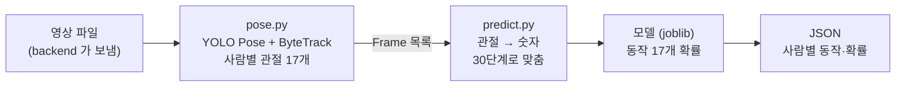

# TEAM3 FastAPI — 동작 추론 서버

영상 하나를 받아 **영상 속 사람마다 어떤 동작인지**(17개 중 하나)와 확률을 JSON 으로 돌려주는 AI 서버입니다.
로그인·DB 저장·작업 상태는 backend(Django)가 맡고, 이 서버는 DB 를 모릅니다.

- API 명세서: [API.md](API.md) — backend 와의 약속
- 담당: FastAPI 2명 — @wlgptjd333 · @tjrqja021206-a11y (A: `pose.py` · B: `predict.py` 는 둘이 정함 · 같이: `main.py`, 리뷰)
- backend 가 DB 칸을 정할 때: [API.md — AI 가 줄 수 있는 데이터 최소/최대](API.md#ai-가-줄-수-있는-데이터--최소--최대-backend-db-설계용)

## 1. 하는 일 (그림)



| 파일 | 한 줄 설명 | 담당 |
|---|---|---|
| `main.py` | 서버 시작 때 모델 한 번 불러오기, 주소 2개 (`/health`, `/predict`) | 같이 |
| `schemas.py` | 주고받는 JSON 모양 (backend 와의 약속) | 같이 |
| `pose.py` | 영상 → 사람별 관절 목록 | A |
| `predict.py` | 관절 목록 → 동작·확률 | B |
| `tests/` | 주소가 약속대로 답하는지 | 같이 |

**지금 상태:** 모델 파일이 없으면 **가짜 모드**로 켜져서 [API.md](API.md) 의 예시 JSON 을 그대로 돌려줍니다.
backend·frontend 는 이걸로 먼저 붙여서 개발하고, 우리는 `pose.py` · `predict.py` 의 `TODO` 를 채웁니다.

## 2. 실행

```bash
python3 -m venv .venv && source .venv/bin/activate
pip install -r requirements.txt -r requirements-dev.txt
uvicorn main:app --reload --port 8001      # http://127.0.0.1:8001/docs
pytest                                     # 테스트
```

Docker: `docker build -t team3-fastapi . && docker run -p 8001:8001 team3-fastapi`

모델 파일은 Git 에 올리지 않고 `models/` 에 직접 둡니다 ([models/README.md](models/README.md)).

## 3. 같이 일하는 규칙

1. `main` 에 바로 push 하지 않는다. 브랜치(`feat/pose-track` 처럼) → PR → **다른 FastAPI 담당이 리뷰** → merge.
2. PR 은 작게 (함수 하나, 300줄 이하). PR 양식의 체크를 채운다.
3. 생성형 AI 는 **함수 하나씩** 시킨다. 입력·출력·하는 일을 내가 먼저 한 줄로 적고 시킨다.
4. 받은 코드에는 **내 말로 주석**을 단다. 주석을 못 달면 그 줄은 아직 이해 못 한 것.
5. 리뷰: **상대가 설명 못 하는 줄이 있으면 merge 하지 않는다.**
6. `schemas.py` · `API.md` 를 바꾸면 backend 담당도 리뷰에 넣는다.

## 4. 할 일

- [ ] A: `pose.extract_people` — 영상 열기, YOLO track, 사람별 Frame 쌓기
- [ ] B: `predict.predict_person` — 학습 때와 같은 숫자 만들기, 30단계, 모델 확률
- [ ] 모델 파일 정하기 (팀 학습 결과) → `models/` 에 두고 가짜 모드 끄기
- [ ] 짧은 영상 하나로 진짜 `/predict` 테스트 추가
- [ ] A·B 나누기 (둘이 정해서 위 담당 줄 고치기)
- [ ] backend 가 Celery 에서 `/predict` 를 불러 가짜 응답을 받는지 확인 (기능 하나씩: 먼저 이것만)
- [ ] backend 와 `docker compose` 로 연결 확인

참고 (개인 프로젝트에서 이미 겪은 것):
[pose_pipeline.py](https://github.com/wlgptjd333/store-anomaly-service/blob/main/ai_service/services/pose_pipeline.py) ·
[action_inference.py](https://github.com/wlgptjd333/store-anomaly-service/blob/main/ai_service/services/action_inference.py)
— 모델은 서버 시작 때 한 번만, 무거운 함수는 `def`, 학습 때와 같은 Feature 계산.
